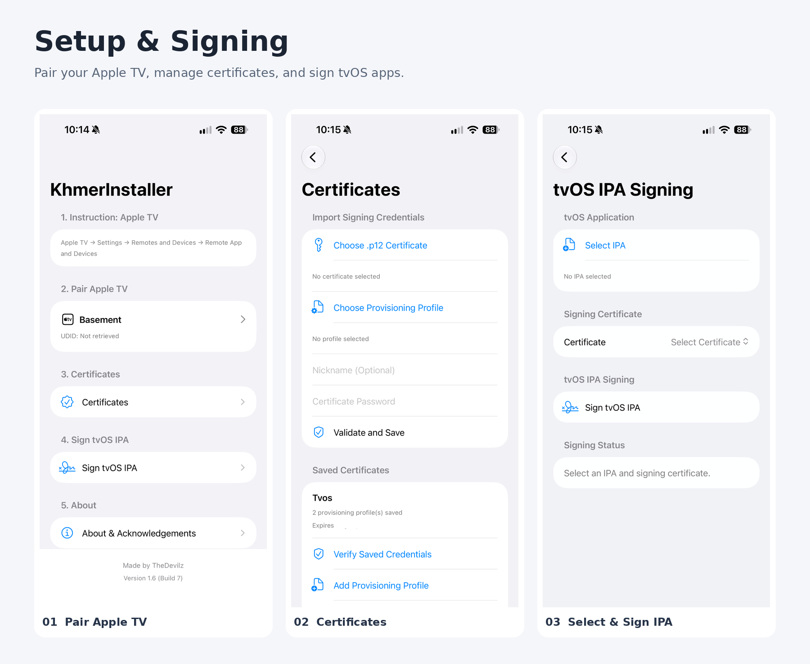
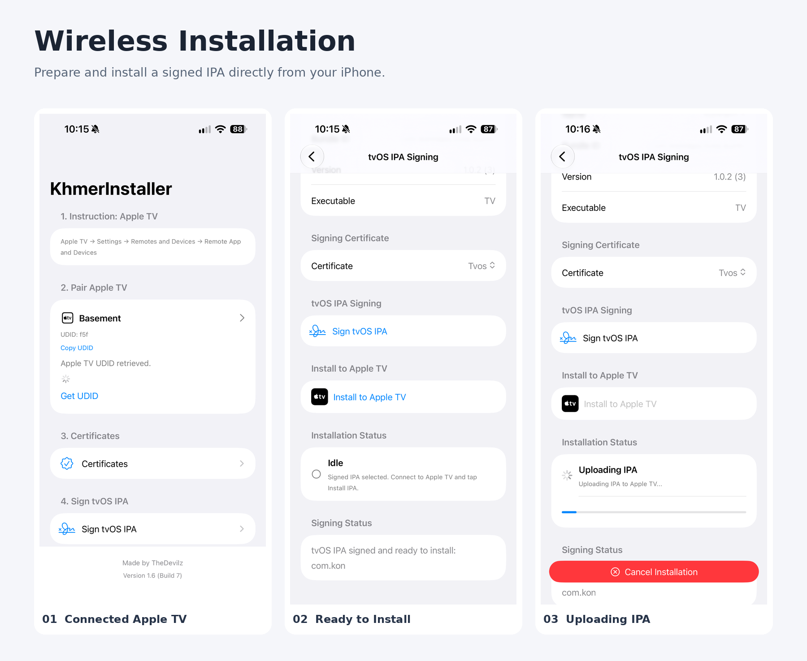

  

  <h1>KhmerInstaller</h1>

  

    An iOS app for signing tvOS IPA packages and installing them wirelessly on a compatible Apple TV.
  

## What It Does

- Runs directly on an iPhone and performs the Apple TV workflow wirelessly.
- Does not require a PC, Mac, or Linux computer for normal signing and installation use after KhmerInstaller is installed on the iPhone.
- Pairs with a compatible Apple TV.
- Imports a tvOS IPA selected by the user.
- Manages signing certificates and provisioning profiles used for IPA signing.
- Validates signing credentials and relevant IPA information before signing.
- Re-signs and packages the selected tvOS IPA.
- Prepares the signed IPA for installation on the paired Apple TV.
- Starts installation and displays installation status and results.
- Includes safeguards for failed or cancelled workflows and cleanup of temporary signing workspaces.
  <h2>Screenshots</h2>

<h3>Setup & Signing</h3>

  

<h3>Wireless Apple TV Installation</h3>

  

## Project Scope

- KhmerInstaller is an iPhone app designed to sign and install tvOS IPAs wirelessly, directly from the phone to a compatible Apple TV.
- A separate PC, Mac, or Linux computer is not required for the app's normal operating workflow; a Mac with Xcode is still needed to build the iOS app from source.
- KhmerInstaller is intended for tvOS IPA signing and Apple TV installation.
- The app implements its pairing and RemoteXPC-related functionality natively in Swift.
- The pymobiledevice3 Python package is a development reference and is not bundled as a runtime dependency.
- An Apple Developer signing identity, appropriate provisioning profile, and compatible entitlements may be required to sign and install an IPA. Requirements depend on the app being signed and the target device.

## Third-Party Components

The project includes Zsign and uses Swift packages and other third-party code.

See [THIRD_PARTY_NOTICES.md](THIRD_PARTY_NOTICES.md) and the accompanying license files for attributions and applicable license terms.

## License

KhmerInstaller is distributed under the **GNU General Public License, version 3 (GPL-3.0)**.

See [LICENSE](LICENSE) for the full license text. Third-party components remain subject to their respective license terms.

## Disclaimer

KhmerInstaller is an independent community project and is not affiliated with, endorsed by, or sponsored by Apple Inc.

Use only IPA files and signing credentials that you are authorized to use.
