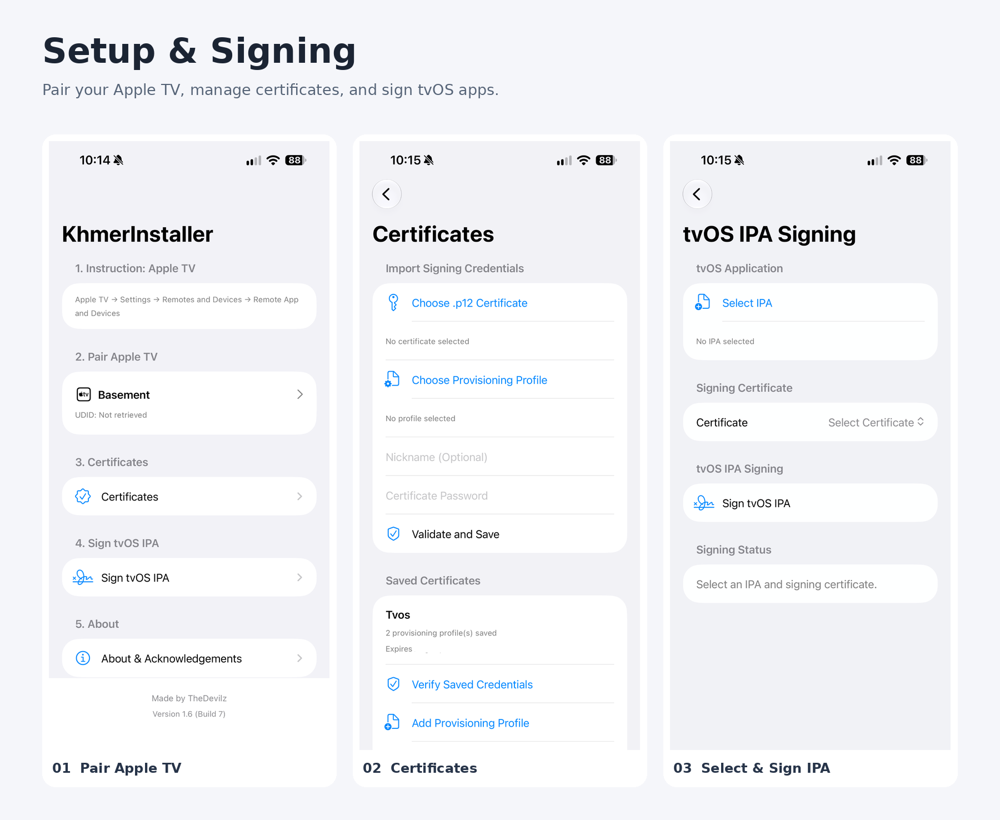
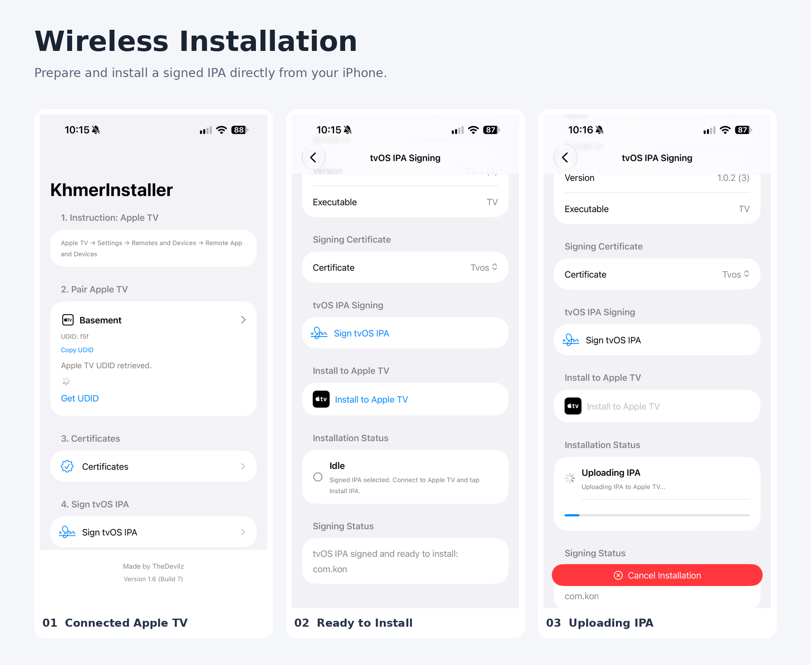

 <div align="center">
  

  <h1>KhmerInstaller</h1>

  <p>
    Sign tvOS IPA packages and install them wirelessly on Apple TV, directly from your iPhone.
  </p>

  <p>
    
    
    
    
    <a href="LICENSE">
      
    </a>
    <a href="https://ko-fi.com/thedevilz">
      
    </a>
  </p>
</div>

## Features

- Wireless pairing and IPA installation on compatible Apple TV devices.
- Import and re-sign tvOS IPA packages directly on an iPhone.
- Certificate and provisioning profile management.
- Signing credential and IPA validation.
- Installation progress, status, and error reporting.
- Automatic cleanup of temporary signing files and failed or cancelled operations.
- No computer required for signing or installation once KhmerInstaller is installed.

## Screenshots

### Setup & Signing

<p align="center">
  
</p>

### Wireless Apple TV Installation

<p align="center">
  
</p>

## Tested Devices & Compatibility

| Device | Operating System | Status |
|---|---|---|
| iPhone 15 Pro Max | iOS 18+ | ✅ Tested |
| Apple TV 4K | tvOS 27.0 | ✅ Tested |
| Apple TV HD | tvOS 26.6 | ✅ Tested |

Other devices may work but have not been officially tested.

## Build from Source

### Requirements

- Mac with Xcode
- iPhone running iOS 18.0 or later
- Apple Developer account with the required capabilities
- Compatible Apple TV

### Build Instructions

1. Clone the repository:

   ```bash
   git clone https://github.com/konrepo/KhmerInstaller.git
   cd KhmerInstaller
   ```

2. Open `KunInstaller.xcodeproj` in Xcode.
3. Select the `KunInstaller` scheme and your iPhone.
4. Under **Signing & Capabilities**, select your Apple Developer Team for both `KunInstaller` and `KunInstallerTunnel`.
5. Configure the following in **Build Settings**:
   - `APP_BUNDLE_ID` — Your unique application Bundle ID.
   - `APP_GROUP_ID` — Your registered App Group identifier.
6. Enable **Network Extension (Packet Tunnel)** and **App Groups** capabilities.
7. Ensure both targets have matching provisioning profiles and required entitlements.
8. Build and run KhmerInstaller on your iPhone.

The Packet Tunnel Bundle ID is automatically derived from `APP_BUNDLE_ID`. Both targets share the configured App Group.

## Signing Requirements

### Signing KhmerInstaller

When manually signing KhmerInstaller, the two targets require:

| Target | Provisioning Profile |
|---|---|
| Main iOS app | Main App profile |
| Packet Tunnel extension | Packet Tunnel profile |

**Required:**
- 1 `.p12` signing certificate and its password.
- 2 provisioning profiles, one for each target.

Both targets can use the same certificate. Provisioning profiles must match their respective Bundle IDs, entitlements, Apple Developer team, and shared App Group.

**Important:** The Packet Tunnel may fail to connect if its capabilities, entitlements, or provisioning configuration are incorrect, even if the app installs successfully.

### Sign KhmerInstaller IPA from Terminal

KhmerInstaller includes a macOS Terminal signing script for signing
the unsigned IPA without opening Xcode.

**Requirements:**

- macOS with Xcode Command Line Tools.
- One compatible Apple signing certificate.
- Two provisioning profiles:
  - Main iOS application profile.
  - Packet Tunnel extension profile.
- Both profiles must authorize the required Network Extension
  capability and a common App Group.

**Run:**

    bash Scripts/sign-ipa.sh

**Signing options:**

1. Import a `.p12` certificate into a temporary Keychain.
2. Use an existing macOS Keychain signing identity.

The script derives the Bundle IDs and shared App Group from the
provisioning profiles and signs the OpenSSL framework, Packet Tunnel
extension, and main application.

**Output:**

- `KhmerInstaller-Signed-P12.ipa`
- `KhmerInstaller-Signed-Keychain.ipa`

The original unsigned IPA is preserved.

**Important:** Use only authorized signing credentials.
Never upload certificates, private keys, or passwords to GitHub.

Signing and signature verification have been tested. Installation
and runtime behavior with other developer accounts remain unverified.

### Signing tvOS IPAs

The signing credentials used for KhmerInstaller are separate from those required for tvOS IPAs.

A standard tvOS app may require one provisioning profile. Apps with extensions or additional signed targets may require additional matching profiles.

## Wireless Installation

1. Connect your iPhone and Apple TV to the same local network.
2. Pair KhmerInstaller with your Apple TV.
3. Import the signing certificate and required provisioning profile(s).
4. Select and sign a compatible tvOS IPA.
5. Install the signed IPA wirelessly.

## Project Scope

- Native Swift implementation of Apple TV pairing and RemoteXPC communication.
- `pymobiledevice3` was used as a development reference and is not a runtime dependency.

## Third-Party Components

KhmerInstaller includes Zsign, Swift packages, and other third-party components.

See [THIRD_PARTY_NOTICES.md](THIRD_PARTY_NOTICES.md) and the accompanying license files for attributions and applicable license terms.

## License

KhmerInstaller is licensed under the **GNU General Public License v3.0 (GPL-3.0)**.

See [LICENSE](LICENSE) for details. Third-party components remain subject to their respective licenses.

## Support

KhmerInstaller is free and open-source. If you find it useful, consider supporting its development.

☕ [Support TheDevilz on Ko-fi](https://ko-fi.com/thedevilz)

## Disclaimer

KhmerInstaller is an independent community project and is not affiliated with, endorsed by, or sponsored by Apple Inc.

Use only IPA files and signing credentials that you are authorized to use.
